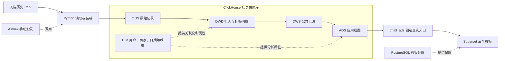

# 数仓设计说明书

系统将天猫历史行为、用户画像和复购训练标签加工成可复用的汇总，向运营看板提供六个查询入口。分析指标可以沿应用视图、公共汇总和明细追溯至原始 CSV 行。

## 系统架构

Python 负责文件校验、装载、执行顺序和任务状态。清洗与聚合由 ClickHouse 执行 SQL。Airflow 提供手动触发、运行记录和任务日志。Superset 以只读账号查 ClickHouse，图表定义、筛选配置和看板布局保存在 PostgreSQL。

## 事实与维度

维度设计先定业务过程和一行所代表的范围，再选维度及度量。 [Kimball 四步维度设计](https://www.kimballgroup.com/data-warehouse-business-intelligence-resources/kimball-techniques/dimensional-modeling-techniques/four-4-step-design-process/)

| 业务过程 | 粒度 | 关联维度 | 度量来源 |
|---|---|---|---|
| 商品互动 | 一条有效行为，保留 `source_row` | 共享用户键 `user_key` 和商家键 `merchant_key`，另有商品、事件类目、事件品牌、日序和动作 | 行为记录计数，动作码识别购买，用户键用于去重 |
| 复购训练样本 | 一对有有效标签的用户和商家 | 共享用户键和商家键 | `repeated` 为 0 或 1，汇总样本对数和正标签对数 |

`dim_user` 来自 ODS 画像，`dim_merchant` 从原始行为和标签合并得到商家编号。商品、类目、品牌的维度视图从行为明细提取唯一编号。日期维度生成业务月日和日序，动作维度提供编码对应的中文名称。行为事实保留源记录中的类目和品牌键，同一商品出现在不同类目或品牌时，保留各条事件的取值。

## 分层对象

| 层 | 数据库对象 | 设计用途 |
|---|---|---|
| ODS | `ods_behavior`、`ods_user`、`ods_label`，均为物理表 | 保存源字段和行号，支持复核、清洗和失败定位 |
| DIM | `dim_user`、`dim_merchant`、`dim_item`、`dim_category`、`dim_brand`、`dim_day`、`dim_action`，均为视图 | 提供可共享的业务身份和分析属性 |
| DWD | `dwd_behavior` 为物理表。标签 `dwd_repeat_label` 和隔离明细 `dwd_behavior_quarantine` 为视图 | 统一键的类型并生成日序，分开保存行为和标签粒度 |
| DWS | `dws_merchant_user_day`、`dws_category_brand_day`、`dws_merchant_repeat`、`dws_merchant_return_7d`，均为物理表 | 复用商家用户日、类目品牌日、商家标签、商家回访等汇总 |
| ADS | 批次快照中的六个 `ads_` 视图和对外的六个同义查询入口 | 支持商家全期与日报、类目品牌、用户分群、标签复购及回访 |

DWS 商家用户日保留用户键，区间人数可用 `uniqExact(user_key)` 重算。回访计算按商家和用户分桶，找同一商家同一用户在每个起算日后的首次活跃日。全量视图按商家和起算日合并各桶的分子、分母。

## 存储、快照与发布

- 行为明细使用 ClickHouse `MergeTree`，按月日码的月份分区，排序键为商家、日序、用户、源行号。商家用户日表按商家、用户、日序排序。
- 批次标识由三份源文件内容、运行范围、加工版本和运行用途决定。每次需要实际装载时使用独立快照库，结果写入 `tmall_control.runs`。校验通过后快照登记为 `published`，同批再次运行时复用并复核。
- 维护者执行应用发布脚本，将 `tmall_ads` 的六个视图指向最新通过校验的全量快照。看板连接与读取路径固定。视图逐个更新，发布后需验证六个入口。
- 看板连接使用 `bi_reader`。可追溯明细由具备权限的 `warehouse` 账号读取。发布与复核步骤见[部署与运维手册](部署与运维手册.md)。

## 一条行为怎样进入日报

源行 `405194` 记录用户 `311541` 在 `0511` 收藏商家 `3828` 的商品。ODS 保存源字段，DWD 统一键类型并生成日序 `1`。DWS 把这条记录计入对应商家、用户、日组合，记录行为量 `1`、购买标志 `0`。ADS 按商家和日期对全部用户汇总，得到商家 `3828` 在 `0511` 的 272 条行为、184 位活跃用户、70 位购买用户。
